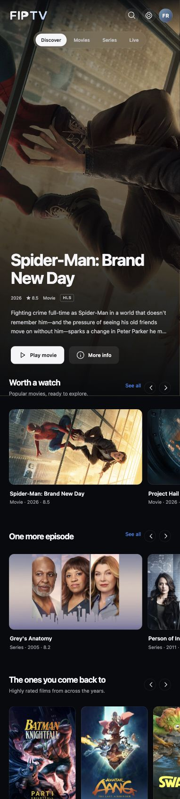

<div align="center">

#  FreeIPTV

**A local IPTV server, populated with media by manipulating existing illegal streaming services**

Movies, series, and live sports through an Xtream-compatible API and M3U playlists.


[Quick start](#quick-start) · [Web interface](#web-interface) · [Connect your player](#connect-your-player) · [How it works](#how-it-works) · [API reference](IPTV.md)

</div>

---

## Overview

FreeIPTV runs on your computer and exposes external web-player streams to IPTV
apps on your local network. One Node.js process handles the catalog, playback
resolution, and HLS relay. A cinematic web interface lets you browse, watch, and
manage the server. The terminal dashboard keeps connection details visible above
a live request log.

| Feature | What you get |
| --- | --- |
| **Player compatibility** | Xtream-compatible login and M3U playlists |
| **Movies and series** | Upstream listings, artwork, seasons, and episode details; optional TMDB fallback |
| **Live sports** | Scheduled events, a sports-only playlist, and an XMLTV guide |
| **Provider fallback** | Cinejoy, Atlantic, Tvids, Zstream, Vidrift, and VidSrc |
| **HLS playback** | Local stream relay, highest advertised video quality, and supported subtitles |
| **Terminal dashboard** | Fixed connection panel with incoming requests and server activity below |
| **Web interface** | Full-screen artwork, animated cards, search, title pages, episodes, and browser playback |
| **Provider settings** | Reorder or disable sources, set time budgets, and choose adaptive or highest quality |
| **Multiple accounts** | Administrator and viewer roles, separate IPTV links, account expiry, and access controls |

> **Availability:** Catalog entries and scheduled events do not guarantee a
> playable stream. Playback depends on external sources and your internet
> connection. Keep the host computer running while you use the service.

## Quick start

### Requirements

- **Node.js 24 or newer**, with npm
- Internet access for metadata and streams
- An IPTV player that supports Xtream Codes or M3U

### Install and run

Clone the repository using a GitHub account with access:

```sh
git clone https://github.com/JackHars/freeiptv.git
cd freeiptv
npm ci
npm start
```

On first launch, choose a **username** and **password**, then confirm the
password. Password entry is hidden. This becomes the **owner administrator** for
both the website and IPTV apps. There are **no default credentials**.

The catalog uses upstream providers automatically. **No TMDB account or API key
is required.** To add TMDB as a backup source, save your own credential and enable
its fallback in **Settings → Metadata**. Existing saved credentials are retained;
the new fallback setting starts disabled.

On later interactive launches, press **Enter** to keep a saved value or enter a
replacement. If you change your login, update it in your IPTV apps too. To run
without an interactive terminal, complete the first setup in a terminal; later
starts reuse the saved credentials.

## Web interface

Open the **Web interface** address printed in the terminal, or
`http://localhost:8091` on the host computer, and sign in with your IPTV account.
Use the server’s LAN address on another device.

<p align="center">
  <a href="docs/screenshots/home.jpg"></a>
  <br>
  <sub>The Discover home screen, captured in fullscreen Chrome.</sub>
</p>

- **Discover, Movies, and Series:** Browse artwork, search titles, inspect details,
  choose a season and episode, and play in the browser. Save titles to **My List**
  on the current browser.
- **Live:** Browse scheduled sports and try available broadcasts.
- **Settings → IPTV connections:** Copy Xtream credentials, M3U playlists, and the
  XMLTV guide. Administrators can select any account; viewers see their own.
- **Settings → Metadata:** Keep upstream providers as the default, optionally
  enable TMDB fallback, and verify, replace, or remove your TMDB credential. Only
  administrators can change these settings; saved credentials are never returned
  to the browser.
- **Settings → Providers:** Drag providers into fallback order or use the arrow
  buttons. Enable sources individually, adjust timeouts and caching, and choose
  highest available or adaptive video quality.
- **Settings → Users:** Create, edit, disable, expire, or delete users. Viewers can
  watch and manage their own login. Administrators also manage server settings
  and other users. The owner remains an active administrator.
- **Settings → General, Library, and Activity:** Set the server name and connection
  address, manage catalog imports, and inspect recent requests.

Most settings apply to new requests immediately. Listen address and port changes
require a restart. Changing an account or disabling it invalidates its old browser
sessions and signed media links; update saved credentials in its IPTV apps.
Browser sessions also end when the server restarts.

The web player uses locally served **hls.js**, or native HLS where supported.
Codec support depends on the browser; an IPTV app may support formats that your
browser cannot play. Keyboard focus and reduced-motion preferences are supported.

### Terminal dashboard

Once the server starts, the fixed connection panel displays:

- Web interface and Xtream server addresses, username, and password
- Full M3U playlist and sports-only playlist URLs
- XMLTV guide URL and stream format

Incoming requests and server activity appear below the panel. Request logs omit
credentials and signed media tokens. Keep the terminal open while using the
server, and press **Ctrl+C** to stop it. Owner login changes made on the website
also update the terminal’s connection panel.

## Connect your player

### Xtream Codes

1. Start FreeIPTV and open your IPTV app.
2. Add a provider using **Xtream Codes**, **Xtream API**, or **username/password login**.
3. Copy the connection details from **Settings → IPTV connections** or the terminal:

| Player field | Value |
| --- | --- |
| **Server / portal URL** | The **IPTV server** address, for example `http://192.168.1.100:8091` |
| **Username** | The selected account’s username |
| **Password** | The selected account’s password |
| **Stream format** | **HLS / m3u8**, if requested |

4. Save the provider and open **Movies**, **Series**, or **Live TV**.

### M3U and TV guide

Copy the terminal's **M3U playlist** URL into your player's M3U URL field. For an
EPG or TV guide, use the **XMLTV guide** URL. Use the **sports-only playlist** URL
if you only want live events.

Refresh the provider or playlist after changing the catalog. See the
[IPTV connection and API reference](IPTV.md) for endpoints, playlist options,
and catalog management.

## How it works

```text
IPTV player on your LAN
        |
        | Xtream API / M3U / XMLTV
        v
FreeIPTV on your computer
        |
        +-- Upstream catalog ------> Movie and series metadata
        +-- TMDB (optional) -------> Metadata fallback
        +-- Six playback providers -> Movie and episode HLS sources
        +-- Sports event pages ----> Schedules and published HLS sources
        |
        +-- Local HLS relay -------> Playlists, segments, keys, and subtitles
```

### 1. Build the catalog

FreeIPTV tries **7Movies / Vidrift**, then **Atlantic**, then the alternate
7Movies domain. Atlantic supplies a separate metadata endpoint, so a 7Movies
outage can fall back to another provider before its mirror. Those endpoints provide
popular and highly rated lists, search results, title details, credits, artwork,
and seasons. The server normalizes their responses for the web UI and Xtream,
keeps existing title and episode IDs, and caches metadata locally. Catalog imports
use release-year filters to expand beyond the main lists. New installations get
a starter catalog first, then expand it in the background at a paced request
rate. Web browsing and existing IPTV listings remain available during imports.

**TMDB is an optional fallback**, disabled by default. Enable it in
**Settings → Metadata** after saving your own API key or Read Access Token. It is
used when upstream information is missing or unavailable. Credentials are checked
with TMDB when you save them; no shared credential is bundled. Without a fallback,
cached information remains usable during temporary outages where available.

These upstream endpoints serve TMDB-derived information, and artwork still
loads from its image CDN. No personal API credential is required for upstream
metadata, but TMDB IDs and images are still used. Sports schedules use a separate adapter and do not
require a TMDB credential. Catalog entries describe titles, not confirmed video
availability.

### 2. Resolve playback on demand

When you play a movie or episode, FreeIPTV tries these providers in order and
uses the first source that passes its HLS and video-segment checks. This is the
default order; change it in **Settings → Providers**:

| Order | Provider | How playback is resolved |
| --- | --- | --- |
| 1 | **Cinejoy** | Sends the TMDB ID through `api.wing.st` using the bundled `crush.wasm` lumen-gate encoder, then decrypts the reply and tries its video mirrors. |
| 2 | **Atlantic** | Tries Athena, Aphrodite, and Moscow; Moscow's encrypted source URL is decoded with AES-GCM. |
| 3 | **Tvids / Xpass** | Reads the embed's data URL, derives its AES-GCM key, decrypts the backup list, and checks the returned playlists. |
| 4 | **Zstream** | Calls the shared Cinecat / P-Stream scraper and selects a working HLS source with its supplied playback headers. |
| 5 | **Vidrift** | Gets a playback token from the 7movies family, loads Vidrift's boot response, and tries its Bigbang and Vexon HLS sources. |
| 6 | **VidSrc** | Looks up the IMDb ID through the metadata layer, follows the gate/player chain, extracts rotating key tables from the supplied WASM, decrypts the URL list with ChaCha20, and obtains a media-host token. |

Series requests include season and episode numbers. Failed providers are skipped;
successful resolutions are cached for five minutes by default. Default attempts
have a 30-second budget per provider and a 180-second overall budget. These values
are configurable in the web settings. Availability varies
by title and provider. Direct MP4-only results are skipped because this server
serves HLS to IPTV players.

All six adapters run inside the existing Node.js process. The new adapters were
ported from Red Hermes' October 25, 2026 research using Node's built-in crypto.

VidSrc needs an IMDb ID. Upstream movie details normally include one; Atlantic
also supplies series mappings without a personal TMDB key. A missing mapping makes VidSrc fail
for that title, allowing the other enabled playback providers to be tried.

### 3. Reproduce each web player's requests

Each provider supplies its own browser-style **User-Agent**, **Origin**, and
**Referer**. FreeIPTV retains these headers when checking a source and when
relaying its playlists, video segments, encryption keys, and alternate tracks.
Cinejoy, for example, uses the `cinejoy.pk` Origin and Referer. This reproduces
the web player's request headers; it does not grant access to an unpublished
stream.

The resolver checks the highest advertised video rendition and samples its first
segment before accepting it. HTML error pages and image-based placeholder feeds
are rejected so another source or provider can be tried. The terminal log shows
which provider was selected.

### 4. Relay the stream to your player

FreeIPTV fetches the HLS playlist, selects the highest advertised video quality
(or retains all variants in adaptive mode), and rewrites remote playlist, segment,
and key URLs as **signed local URLs** tied to the requesting user.
Your IPTV app requests those local URLs; FreeIPTV forwards the requests with the
required headers and streams the returned bytes back. Supported subtitle tracks
can also be attached. Videos are not saved as a local library.

### 5. Resolve sports feeds separately

The sports adapter follows published iframe or player links from event pages to
find an HLS feed. It relays that feed using the source page's `Referer`, `Origin`,
and browser-style User-Agent. A scheduled event remains unplayable until its
source publishes a supported HLS link. The repository contains no permanent TV
channels or video library.

## Configuration

Use **Settings** in the web interface for saved server, provider, catalog, and
account configuration. Environment variables override the saved listen address
and port:

| Setting | Default | Purpose |
| --- | --- | --- |
| `HOST` | `0.0.0.0` | Network interface to listen on |
| `PORT` | `8091` | HTTP server port |

For access only from the host computer:

```sh
HOST=127.0.0.1 npm start
```

To use another port:

```sh
PORT=8092 npm start
```

FreeIPTV is intended for a **trusted local network** and is not configured for
public access. If a firewall is enabled, allow the configured port on your
trusted LAN. Other devices must be able to reach the host computer.

### Saved data

The server creates `data/` on first launch. It holds accounts, server settings,
signing secret, catalog, and metadata caches. Accounts and settings are saved in
`data/iptv.json`; passwords are stored there so IPTV connection links can be
shown and copied. An optional TMDB credential is stored in the same private file,
separately from playback providers, and is sent only to TMDB. The directory is
excluded from Git. Keep it private and back it up.

Existing single-account installations migrate automatically. The existing login
becomes the owner, and `data/iptv.pre-users.json` keeps a one-time backup of the
original account file. Existing catalogs and pinned titles are retained.

`data/`, `config.json`, and environment files are excluded from Git. Additional
catalog settings and cache details are documented in [IPTV.md](IPTV.md#local-data-and-configuration).

## Verification

Check the source syntax:

```sh
npm run check
```

With the server running, check its health:

```sh
curl http://localhost:8091/health
```

Test provider resolution, fallback, encryption, and the local media relay:

```sh
npm run test:providers
npm run test:web
npm run test:metadata
```

For the available test commands and API checks, see [IPTV.md](IPTV.md#checks).
